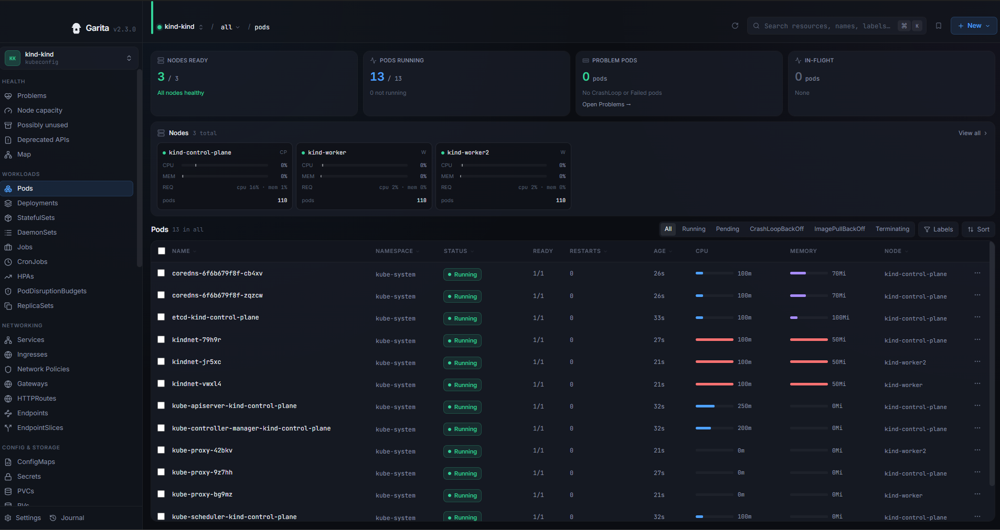

# Garita

Garita (gah-REE-tah) is the Spanish word for a fortress sentry box.

A cross-platform desktop GUI for managing Kubernetes clusters, built with Tauri v2, React 18 and Rust. Every Kubernetes call goes from the Rust backend through kube-rs; there is no `kubectl` binary dependency.



**Your kubeconfig is read-only to Garita.** It reads your default kubeconfig plus any kubeconfig files you import in-app, by file picker or by pasting YAML, both behind a preview of the contexts the file defines. Imported files are registered by path, never merged into `~/.kube/config`, and removing one deletes nothing from disk. Selecting a cluster in Garita does not change your `kubectl` default.

## Installation

Direct downloads from the latest GitHub release; the links always point at the newest version.

| Platform | File |
|---|---|
| macOS (Apple Silicon) | [`Garita-macOS-arm64.dmg`](https://github.com/KANOMNUT/garita/releases/latest/download/Garita-macOS-arm64.dmg) |
| Linux (Debian/Ubuntu) | [`Garita-linux-amd64.deb`](https://github.com/KANOMNUT/garita/releases/latest/download/Garita-linux-amd64.deb) |
| Linux (Fedora/RHEL) | [`Garita-linux-amd64.rpm`](https://github.com/KANOMNUT/garita/releases/latest/download/Garita-linux-amd64.rpm) |
| Windows (x86_64) | [`Garita-windows-amd64-setup.exe`](https://github.com/KANOMNUT/garita/releases/latest/download/Garita-windows-amd64-setup.exe) or [`Garita-windows-amd64.msi`](https://github.com/KANOMNUT/garita/releases/latest/download/Garita-windows-amd64.msi) |

macOS is ARM64 only; Linux and Windows are x86_64 only.

Needs a current system webview: macOS 13.3 or later (on macOS 12, install the latest Safari; untested), Ubuntu 22.04 or later with updates, Fedora/RHEL (rpm) with current webkit2gtk, Windows 10 or later.

Unsigned: Windows SmartScreen will warn. Choose "More info", then "Run anyway". After installing, open a new terminal window to use the `garita` command. Or with Scoop:

```powershell
scoop install https://kanomnut.github.io/garita/scoop/garita.json
```

**Homebrew (macOS):**

```bash
brew tap KANOMNUT/garita https://github.com/KANOMNUT/garita
brew install --cask kanomnut/garita/garita
```

`brew upgrade` also updates Garita: Homebrew upgrades a self-updating cask when the installed app is older than the cask.

**macOS without an administrator password:** on a standard account, copying into `/Applications` asks for an administrator. Put Garita in the `Applications` folder inside your home folder instead (`mkdir -p ~/Applications` if it is missing, then drag `Garita.app` from the DMG there); in-app updates then need no password either. With Homebrew, add `export HOMEBREW_CASK_OPTS="--appdir=$HOME/Applications"` to `~/.zshenv` before installing. Homebrew itself needs a prefix your account can write, which an administrator sets up once ([Homebrew: Installation](https://docs.brew.sh/Installation)).

**macOS first launch:** Garita is ad-hoc signed, not notarized, so Gatekeeper blocks a downloaded copy until you run (the Homebrew cask does this for you):

```bash
xattr -rd com.apple.quarantine /Applications/Garita.app      # or ~/Applications/Garita.app
```

**The `garita` command.** `garita [--context <name>] [-n <namespace>] [kind]` opens the app (`garita --help` lists the options).
- macOS: the Homebrew cask adds it; otherwise use Settings → Command line → Install. That links it into `/usr/local/bin` with `sudo`; on a standard account, link `~/Applications/Garita.app/Contents/MacOS/garita` into a folder on your `PATH` that you own instead.
- Linux `.deb`/`.rpm`: it is on your `PATH` after installing.
- Windows: the installer adds its folder to your `PATH` (the `.exe` for your user, the `.msi` for all users); open a new terminal window. If your user `PATH` is too long to extend safely, Settings → Command line shows the folder to add.
- A self-built AppImage adds no command; Settings → Command line shows a link command to copy.

To build from source, see [Development](#development).

## Features

Per-release detail is in [`CHANGELOG.md`](CHANGELOG.md).

### 43 resource kinds

- **Workloads**: Pods, Deployments, StatefulSets, DaemonSets, ReplicaSets, Jobs, CronJobs, HPAs, PodDisruptionBudgets
- **Networking**: Services, Ingresses, NetworkPolicies, Gateways, HTTPRoutes (Gateway API), Endpoints, EndpointSlices
- **Config & Storage**: ConfigMaps, Secrets, PersistentVolumeClaims, PersistentVolumes, StorageClasses, ResourceQuotas, LimitRanges, VolumeSnapshots, cert-manager Certificates
- **RBAC**: ServiceAccounts, Roles, ClusterRoles, RoleBindings, ClusterRoleBindings
- **Cluster**: Nodes, CRDs, PriorityClasses, Events, Mutating/ValidatingWebhookConfigurations
- **Custom Resources**: a sidebar tree of every installed CRD, grouped by API group
- **Helm** releases, **ArgoCD** Applications, **Flux v2** Kustomizations and HelmReleases

### Clusters and access

- **Bring your own kubeconfig**: import extra files, enable or disable each one, and see which file each context came from and which other files it shadows.
- **Context switching** without restarting and without touching your `kubectl` default; scope every view to one namespace or browse cluster-wide.
- **Cluster trust states**: each cluster is classified reachable / unreachable / expired auth / forbidden, with install hints for the GKE, EKS and AKS auth plugins, instead of an empty table.
- **Cluster identity guard**: a colour and label per cluster, shown on the sidebar chip, in the top bar and inside every destructive confirmation.
- **Permission-aware UI**: actions you lack RBAC for are disabled with the reason. Batched `SelfSubjectAccessReview`; fails open, so a cluster that cannot answer keeps every action enabled. Accurate once a specific namespace is selected.

### Browsing

- **Tables** sort by name, namespace, status, restarts and age, with per-type column visibility. Pods filter by Running, Pending, CrashLoopBackOff, ImagePullBackOff, Terminating and Succeeded.
- **Command palette** (⌘K) with cluster-wide fuzzy search across every type and namespace.
- **Refresh**: views poll on an interval; ⟳ in the top bar (or `r`) refreshes now.
- **Summary tab** on every resource: conditions, status fields, owner references, labels and annotations. Secret values decode in-app.
- **Workloads** list their owned pods (resolved through ReplicaSets / Jobs), an ownership tree (Deployment → ReplicaSets → Pods, CronJob → Jobs → Pods) and their pod template with requests and limits.
- **Pod containers**: env vars (ConfigMap/Secret sources link to their page), volume mounts, probes, declared ports, init containers under an `[init]` badge, and restart history with colour-coded exit codes (OOMKilled flagged).
- **Metrics** from `metrics.k8s.io` (needs metrics-server): CPU/MEM bars against request and limit, and sparklines in the node strip and pod rows.

### Pods and logs

- **Logs**: live streaming, previous instance, init containers and download, plus one aggregated tail across up to 20 pods of a workload, colour-tagged per pod.
- **Shell**: an interactive terminal into running containers (xterm.js), plus ephemeral **debug containers** for images without a shell.
- **Log filters**: include, exclude and highlight (regex), level chips, JSON rows, and node or zone narrowing for multi-pod tails.
- **Port forwarding** for pods and Services; pod forwards pre-fill from declared container ports.
- **Bulk pod operations**: delete, restart, copy names/YAML or export logs, with confirmation and partial-success reporting.

### Editing

- **Create**: `+New` / ⌘N opens a form for the kind you are viewing (23 kinds), or a pre-filled YAML example for anything else, with a server-side dry run before you commit.
- **Guided edit**: a form for 19 kinds that previews the exact JSON merge patch and warns when ArgoCD or Flux manages the resource. Fields the form does not model are never touched; immutable fields are shown disabled with the reason.
- **YAML** view and edit for any resource. Save and Helm upgrade show a server-side dry-run diff first.
- **Compare** an object with the same kind in another namespace or cluster, and see which field manager last wrote each field.
- **Merge from file**: a multi-document YAML file, previewed key by key against the live object, dry-run, then merged with per-document results. It is a JSON merge patch, not `kubectl apply`, and never prunes.
- **Workload actions**: scale, restart, pause/resume, rollout history, rollback.
- **Delete** from any table row or detail panel (Helm releases show "Uninstall").
- **Confirmations** on destructive actions (delete, scale-to-zero, rollback, ArgoCD sync/prune, Helm uninstall) name the cluster you are about to act on. Deleting more than 10 pods requires typing the namespace; cluster-scoped deletes require typing the resource name.
- **Read-only mode and guardrails** per cluster: disable every write control, require typing the cluster label to confirm writes, or cap bulk actions. Every write dialog shows the kubectl equivalent.

### Health

- **Problems**: fixed, explainable rules (crash loops, OOM kills, image pulls, unschedulable pods, unavailable workloads, failed Jobs, Services without endpoints, pending PVCs, nodes not ready, expiring certificates, missing readiness probes) with evidence. No scores.
- **Node capacity**: requests, limits and usage against allocatable per node.
- **Hints**: right-sizing per container and the quotas, limit ranges, PDBs, priority class and webhooks that apply or may apply to a workload.
- **Diagnostics**: a local, scrubbed, rotating log file (Settings). Nothing is uploaded.

### Helm and GitOps

- **Helm**: release list, values view/edit/upgrade, install from a configured repo, revision history and rollback. Upgrades extract the chart from the release secret, so private repos, OCI registries, CI-deployed and local charts upgrade without a configured `helm repo`.
- **ArgoCD**: health computed locally from each resource's `.status`, so it works with `resourceHealthSource: appTree` (ArgoCD v2.8+) and needs no ArgoCD login. Managed resources link to their pages, and the Resources tab has its own Refresh / Hard Refresh.

### What Garita deliberately does not do

These are choices, not gaps. Each one trades a convenience for a property you can rely on.

- **No `kubectl` binary dependency.** Every Kubernetes call goes through the API directly, so there is no second tool whose version or PATH can disagree with the app.
- **Never writes to your kubeconfig.** Selecting a cluster is app-local state; your `current-context` and every kubeconfig file stay exactly as you left them.
- **No server-side apply.** Edits are JSON merge patches built from a diff against the live object. Server-side apply conflicts with ArgoCD and Flux, which own fields on the resources you most want to edit.
- **No node shell and no privileged pods.** Garita never schedules a pod on your behalf to get a shell on a node.
- **No built-in AI, no telemetry, no analytics, no crash upload.** Nothing about your clusters leaves your machine.
- **Checks GitHub for new versions.** Garita looks for a new release shortly after launch and once a day. It sends no cluster data. On macOS it installs an update only after you confirm; on Linux and Windows it shows a notice and opens the release page. Turn it off in Settings -> Updates -> "Check for updates automatically".
- **No ArgoCD REST API.** ArgoCD is driven through its CRDs, and resource health is computed from Kubernetes status fields, so no ArgoCD login is needed.
- **No Helm repo add, remove or update.** Garita lists the repos you already configured; changing them is a one-time `helm repo` step in a terminal.
- **No in-cluster agent.** There is nothing to install in, or leave running on, your clusters.
- **A drain never falls back to deleting pods that a PodDisruptionBudget protects.** Drain only evicts. A pod the budget refuses is reported as blocked and left running.

### Cluster auth

Any cluster with standard kubeconfig auth works. Managed platforms need their exec-credential plugin:

| Platform | Needs |
|---|---|
| kubeadm, k3s, k0s, RKE2, kind, minikube, Rancher, OpenShift | Nothing extra (certificate or token auth) |
| GKE | `gke-gcloud-auth-plugin`: `gcloud components install gke-gcloud-auth-plugin` |
| EKS | AWS CLI v2, or `aws-iam-authenticator`: `brew install aws-iam-authenticator` |
| AKS | `kubelogin`: `brew install Azure/kubelogin/kubelogin` |

Plugins are found on the shell `PATH` and in common install locations (Homebrew, the AWS CLI v2 installer, `~/.krew/bin`, `~/.azure/bin`), so they resolve even when the app is launched outside a terminal.

## Development

| Tool | Version |
|---|---|
| Rust (stable, via [rustup](https://rustup.rs)) | >= 1.90 |
| Node.js (npm >= 9) | >= 22.6 |
| tauri-cli | `cargo install tauri-cli --version "^2.0"` |

- **macOS:** Xcode Command Line Tools (`xcode-select --install`; installing them needs an administrator once). The build itself needs no administrator password.
- **Linux:** WebKit2GTK and related packages; `make deps` installs them.
- **Windows:** the MSVC Rust toolchain (`rustup toolchain install stable-x86_64-pc-windows-msvc`) and Visual Studio Build Tools with "Desktop development with C++". `make` runs from PowerShell, cmd or Git Bash and needs Git for Windows.

```bash
git clone https://github.com/KANOMNUT/garita
cd garita
make deps    # Rust targets + npm dependencies for this OS
make dev     # cargo tauri dev, with frontend hot reload
npm test     # Vitest
cargo test --lib --manifest-path src-tauri/Cargo.toml   # Rust unit tests, no cluster needed
```

### Build

Tauri cannot cross-compile, so each platform builds on its own OS. `make help` lists every target and its output path under `src-tauri/target/<triple>/release/bundle/`.

```bash
make build            # current OS, auto-detected
make mac              # macOS ARM64 .dmg
make mac-install      # macOS ARM64 .app, copied to ~/Applications (no administrator password)
make mac-universal    # macOS Universal .dmg (ARM64 + x86_64)
make windows          # Windows x86_64 .msi + NSIS .exe
make linux            # Linux x86_64 .deb + .rpm + .AppImage
make linux-deb        # .deb only   (also linux-rpm, linux-appimage, linux-pacman)
make clean            # wipe dist/ and Rust build artifacts
```

### Layout

| Path | Contents |
|---|---|
| `src/` | React frontend. UI only; all data comes from Tauri commands via `invoke()` |
| `src-tauri/` | Rust backend. Tauri commands in `src/commands/`, Kubernetes access via kube-rs |
| `docs/` | Architecture overview, auth, build and release guides; per-feature contracts in `docs/claude/`; release plans and UX specs |
| `index.html` | Download landing page (GitHub Pages; the app entry is `app.html`) |

### Tech stack

| Layer | Technology | Version |
|---|---|---|
| Desktop shell | Tauri | v2 |
| Frontend framework | React | 18.3 |
| Language (frontend) | TypeScript | 5.4 |
| Build tool | Vite | 6 |
| Styling | Tailwind CSS | 4 |
| Icons | lucide-react | 1 |
| Data fetching / caching | @tanstack/react-query | v5 |
| Terminal emulator | @xterm/xterm + @xterm/addon-fit | 6.0 / 0.11 |
| Language (backend) | Rust | stable >= 1.90 |
| Kubernetes client | kube-rs | 0.95 |
| Kubernetes types | k8s-openapi | 0.23 (v1_31) |
| Async runtime | Tokio | 1 |
| Serialization | serde / serde_json / serde_yaml | 1 / 1 / 0.9 |

## Contributing

See [`CONTRIBUTING.md`](CONTRIBUTING.md) for setup, the checks CI runs and pull request conventions. Report vulnerabilities privately as described in [`SECURITY.md`](SECURITY.md).

1. Create a feature branch from `main`, then run `make deps` and `make dev`.
2. Keep Kubernetes calls and business logic in Rust commands and UI logic in React. Add a TypeScript type for every Rust struct returned via `invoke()`.
3. Run `npm test` and the Rust unit tests, and test on your native platform.
4. Note user-facing changes under `## [Unreleased]` in [`CHANGELOG.md`](CHANGELOG.md).
5. Open a pull request describing the change and the resource or feature it affects.

## License

Garita is licensed under the Apache License 2.0; see [`LICENSE`](LICENSE) and [`NOTICE`](NOTICE). Third-party notices: [`THIRD_PARTY_LICENSES`](THIRD_PARTY_LICENSES).
